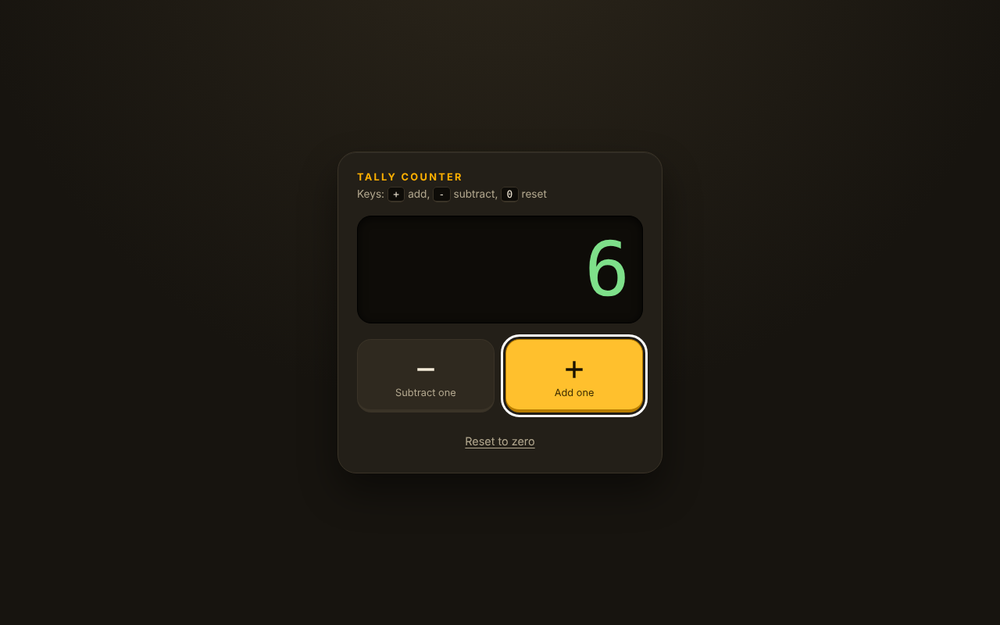
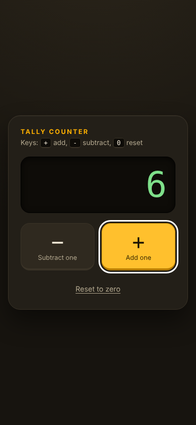

# Tally Counter

A small tally counter built with plain HTML, CSS and JavaScript. Add one, subtract one, reset. The count never goes below zero, and the number turns green once it is above zero.

Live demo: https://simple-counter-delta-three.vercel.app





## Features

- Buttons for add, subtract and reset.
- Keyboard shortcuts: `+` adds, `-` subtracts, `0` resets.
- The count is announced to screen readers (`role="status"` with `aria-live`).
- Visible focus ring, responsive layout, respects `prefers-reduced-motion`.
- System fonts only. No build step, no dependencies, no CDN.

## Run it

Any static file server works:

```sh
python3 -m http.server 5261
# open http://localhost:5261
```

## Project structure

- `index.html`: markup
- `style.css`: design tokens and layout
- `main.js`: counter logic

## Verification

I ran the page in headless Chromium (Playwright) at 1280x800 and 390x844 and checked that: add and subtract change the count, subtract stops at 0, reset returns to 0, the `+`, `-` and `0` keys work, and there are no console errors. There are no automated tests in the repo.

## Known limitations

- The count is not saved. A page reload starts again at 0.

## Notes

UI and code quality improvements were made with AI assistance (Claude, Anthropic), reviewed and verified by building and running the app.
